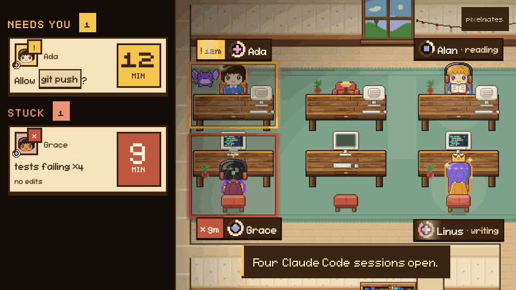
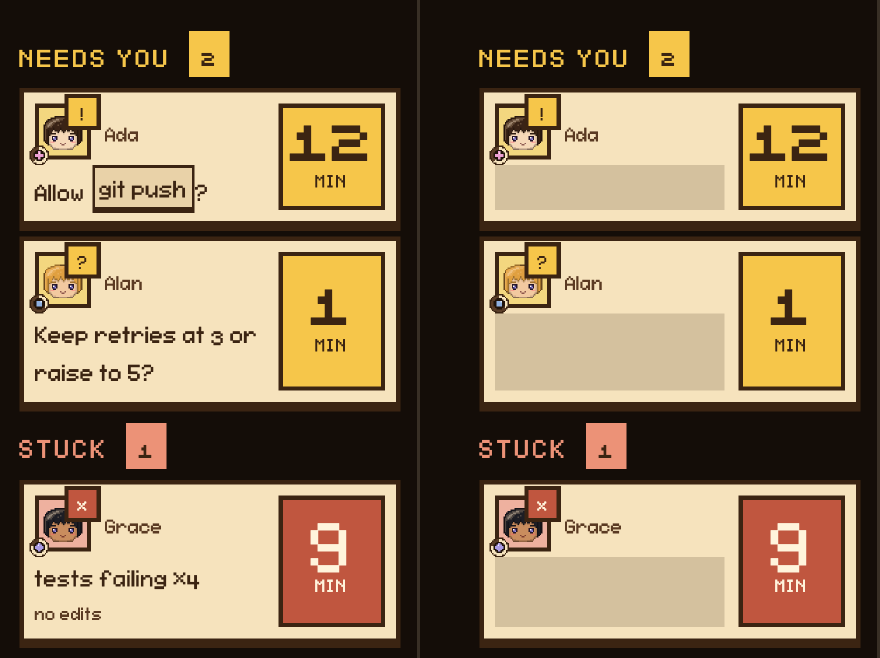
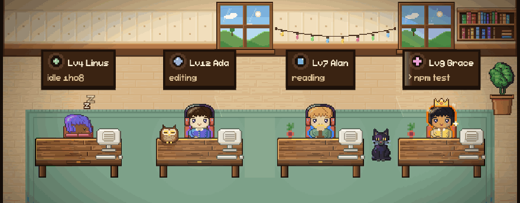
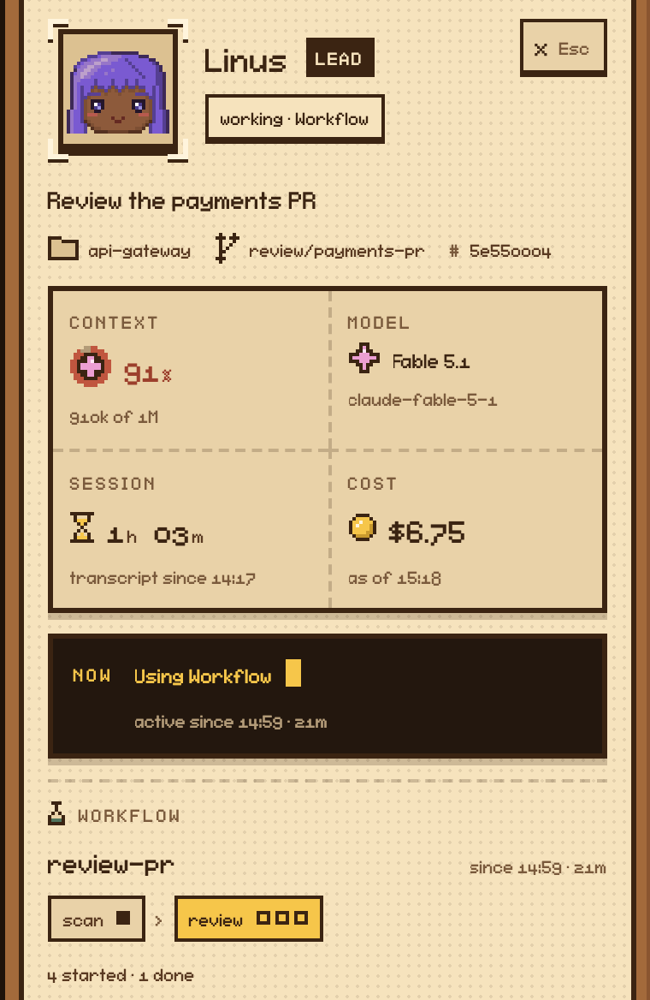

# pixelmates

Your Claude Code sessions as a pixel office. The crew keeps its names and levels between restarts, and a lit desk means a session is waiting on you.

```
npx @pixelmates/cli
```

<p align="center">
  
</p>

pixelmates is a fork of [pixel-agents](https://github.com/pixel-agents-hq/pixel-agents) by Pablo De Lucca (MIT). The engine, the hooks and the layout editor are his work; the art is redrawn by code in this fork.

## Install and run

Open the URL it prints (installed with `npm i -g @pixelmates/cli`, the command is `pixelmates`). The token in it is a secret. The server binds 127.0.0.1 and keeps its roster, layout, token and port in `~/.pixelmates/`.

If you say yes at the consent prompt, it also adds a hook entry to `~/.claude/settings.json`, backed up once to `settings.json.pixelmates.backup`. Undo it with "Instant Detection (Hooks)" in Settings.

Needs Node.js 22+. Step by step with screenshots: [docs/install.md](docs/install.md).

## Coming from Pixel Agents

Your office is copied from `~/.pixel-agents` on first run; nothing there is changed. Pixel Agents hooks are replaced only if you tick "Replace Pixel Agents hooks" in the consent dialog. If you keep both, uninstall pixelmates first, then Pixel Agents.

## Who needs you

Enter inspects, the arrow keys select, P masks session text. A session that is stuck, looping or stalled is named in the rail.

## Privacy



The MCP reads transcripts on this machine and redacts secrets. pixelmates sends nothing off the machine; what the MCP returns reaches Claude like any other tool result.

## A crew that remembers



Each session is a named character that keeps its level across restarts. XP comes only from what your transcripts prove: commit +60, PR created +120, PR merged +200, tests green after an edit +40.

Turns, tool calls and sub-agents pay nothing. `roster.json` holds counts only.

## Every session on one screen



Context, model, branch, cost, helpers and workflow phases. Tripwires are alerts, they block nothing.

## Ask your own history

```
claude plugin marketplace add gustavoortega/pixelmates
claude plugin install pixelmates@pixelmates
```

- `recent_work`: this project's sessions since a date.
- `find_past_work`: did I already look into X.
- `active_now`: sessions active in the last 10 minutes.
- `recent_work_all_projects`: `recent_work` across a directory; asks you every call.

Ask "what did I ship this week?" and get sessions with title, outcome, commits and PRs.

## Why not just agent view?

Claude Code's agent view already lists background sessions that need input and lets you reply there. pixelmates does not replace it. It also covers sessions in your foreground terminals, which agent view shows only after you background them, flags sessions that are stuck or looping, and keeps a crew that earns levels. If a list is enough, use agent view.

## Status

A young fork with few users. File issues at [github.com/gustavoortega/pixelmates](https://github.com/gustavoortega/pixelmates/issues).

## Development

```
git clone https://github.com/gustavoortega/pixelmates.git
cd pixelmates && npm install && npm run build
node dist/cli.js --host 127.0.0.1
```

Dev scenes: `cd webview-ui && npx vite --host 127.0.0.1 --port 5199`, then open `http://127.0.0.1:5199/?scene=hero&hud=0` or `?scene=monitor`.

## Credits and license

Built on [pixel-agents](https://github.com/pixel-agents-hq/pixel-agents) by Pablo De Lucca (MIT). Font: FS Pixel Sans by NZWStudios2024 ([SIL OFL 1.1](webview-ui/public/fonts/OFL.txt)). [LICENSE](LICENSE).
