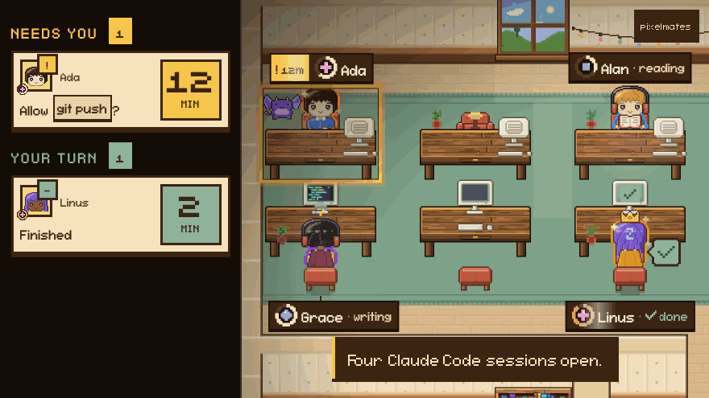
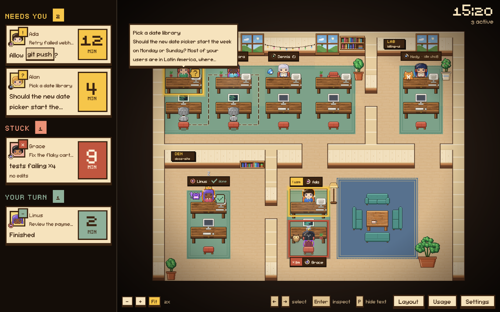
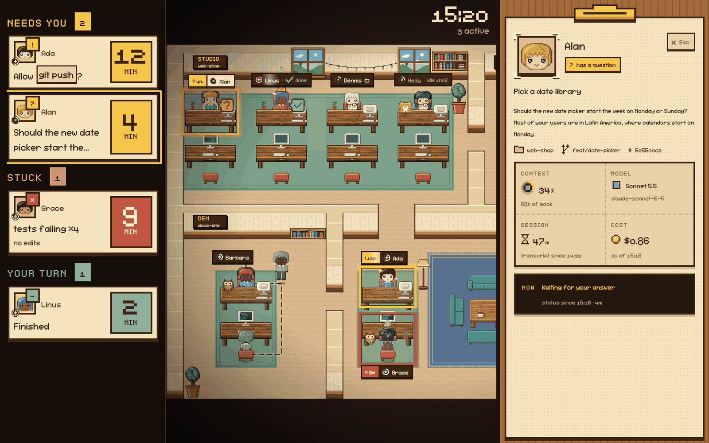
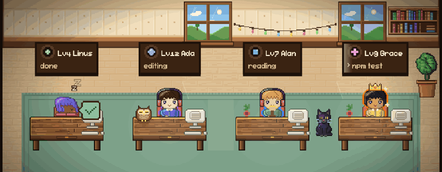
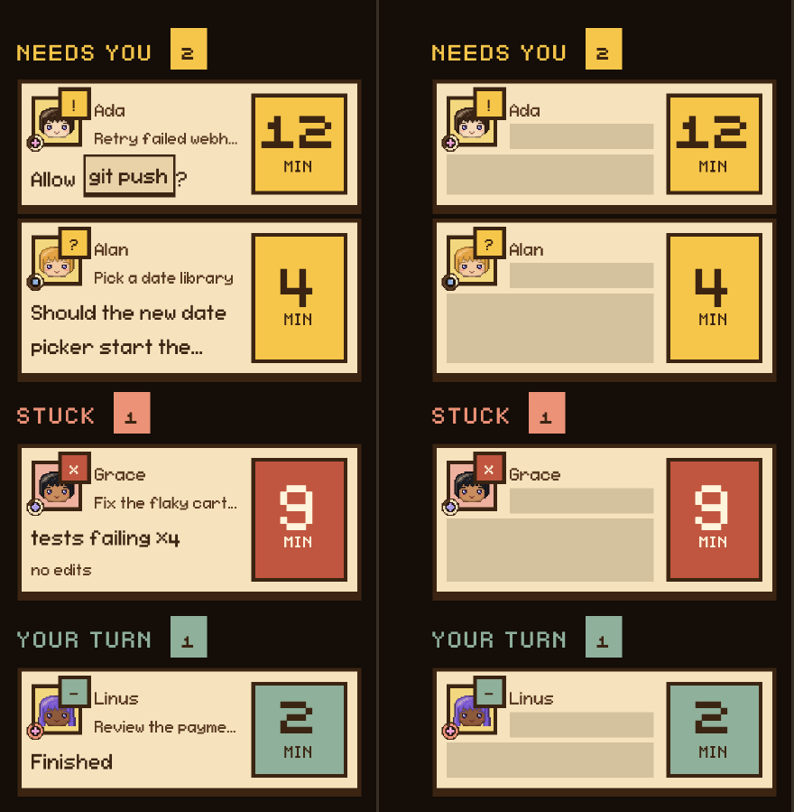

# pixelmates

[](https://www.npmjs.com/package/@pixelmates/cli) [](LICENSE) 

See which Claude Code session is waiting on you and what it asked. pixelmates draws every session, from every folder, as a character in a pixel office in your browser. The server runs on 127.0.0.1 and sends nothing off your machine.

```
npx @pixelmates/cli
```

<p align="center">
  
</p>

Fork of [pixel-agents](https://github.com/pixel-agents-hq/pixel-agents) by Pablo De Lucca (MIT). The engine, the hooks and the layout editor are his work; the art is redrawn by code in this fork.

## What it shows

- **Needs you**: a permission prompt names its command; a question shows its own words, including one asked in plain text at the end of a turn. The desk lights up.
- **Your turn**: a session that finished sits in its own list with a check beside its head. Its desk stays dark.
- **Stuck, looping, stalled**: named in the rail, with the minutes.
- **Inspector**: the whole question, then context, model, branch, cost, helpers and workflow phases.
- **A crew**: names and levels survive restarts. XP comes only from commits, PRs, merges and green tests.
- **P** masks every session string before you share your screen.
- **A plugin** gives Claude read-only tools over your past sessions: "what did I ship this week?"

## Install and run

Open the URL it prints. The token in it is a secret. Installed with `npm i -g @pixelmates/cli`, the command is `pixelmates`. Roster, layout, token and port live in `~/.pixelmates/`.

If you say yes at the consent prompt, it adds a hook entry to `~/.claude/settings.json`, backed up once to `settings.json.pixelmates.backup`. Undo it with "Instant Detection (Hooks)" in Settings. Without hooks it reads transcripts, slower, and a question asked in plain text is not detected.

Needs Node.js 22+. Step by step with screenshots: [docs/install.md](docs/install.md).

## Who needs you



The rail ranks the sessions that need you: Needs you, then Stuck, then Your turn. A gold `?` beside a character's head means it asked you something; a sage check means it finished. The browser tab counts permission prompts and questions, `(2) pixelmates`, and its icon gets a gold dot.

Arrow keys select. Enter or a double-click on a ticket, a character or its card opens the inspector. Opening a Your turn session marks it seen: it leaves the list and its check dims until its next turn. Esc or a click on the floor deselects.



## A crew that remembers



Each session is a named character that keeps its level across restarts. XP comes only from what your transcripts prove: commit +60, PR created +120, PR merged +200, tests green after an edit +40. Turns, tool calls and sub-agents pay nothing. `roster.json` holds counts only.

## Privacy



P masks session text; names, minutes and counters stay. The server binds 127.0.0.1 behind a token and sends nothing off the machine. The plugin's MCP reads transcripts on this machine and redacts secrets; what it returns reaches Claude like any other tool result.

## Ask your own history

```
claude plugin marketplace add gustavoortega/pixelmates
claude plugin install pixelmates@pixelmates
```

- `recent_work`: this project's sessions since a date.
- `find_past_work`: did I already look into X.
- `active_now`: sessions active in the last 10 minutes.
- `recent_work_all_projects`: `recent_work` across a directory; asks you every call.

Ask "what did I ship this week?" and get sessions with title, outcome, commits and PRs.

## Why not just agent view?

Claude Code's agent view already lists background sessions that need input and lets you reply there. pixelmates does not replace it. It also covers sessions in your foreground terminals, which agent view shows only after you background them, flags sessions that are stuck or looping, and keeps a crew that earns levels. If a list is enough, use agent view.

## Coming from Pixel Agents

Your office is copied from `~/.pixel-agents` on first run; nothing there is changed. Pixel Agents hooks are replaced only if you tick "Replace Pixel Agents hooks" in the consent dialog. If you keep both, uninstall pixelmates first, then Pixel Agents.

## Hack on it

```
git clone https://github.com/gustavoortega/pixelmates.git
cd pixelmates && npm install && npm run build
node dist/cli.js --host 127.0.0.1
```

Demo scenes with made-up data: `cd webview-ui && npx vite --host 127.0.0.1 --port 5199`, then open `http://127.0.0.1:5199/?scene=monitor` or `?scene=hero`. Only Claude Code is supported today. Its provider lives in `server/src/providers/hook/claude/`; another CLI would sit next to it. See [CONTRIBUTING.md](CONTRIBUTING.md).

A young fork with few users. Bugs and ideas: [issues](https://github.com/gustavoortega/pixelmates/issues). What changed: [CHANGELOG.md](CHANGELOG.md).

## Credits and license

Built on [pixel-agents](https://github.com/pixel-agents-hq/pixel-agents) by Pablo De Lucca (MIT). Font: FS Pixel Sans by NZWStudios2024 ([SIL OFL 1.1](webview-ui/public/fonts/OFL.txt)). [LICENSE](LICENSE).
