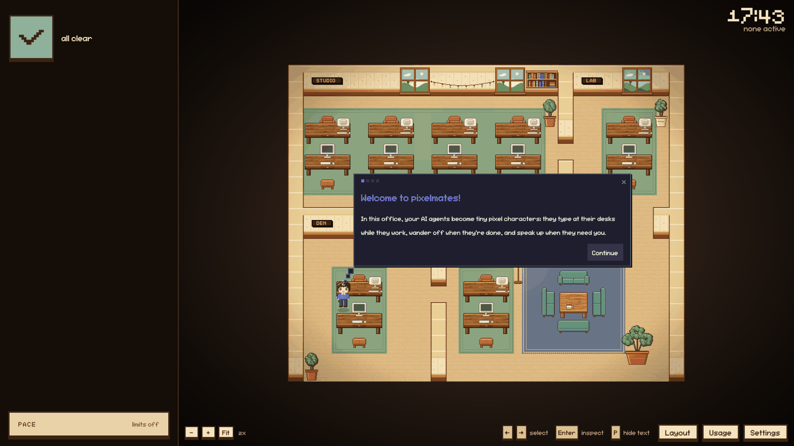
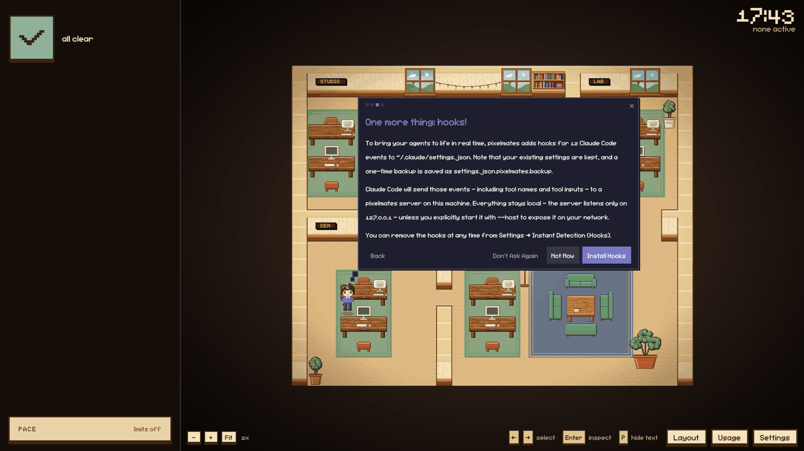
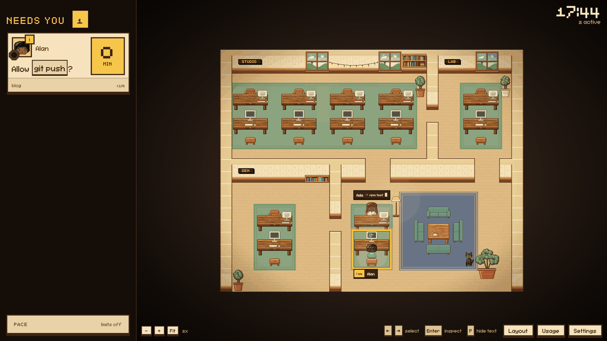

# Install pixelmates

You need Node.js 22 or newer (`node -v`). With a version manager, switch first, for example `nvm use 22` or `fnm use 22`.

## 1. Start the server

```
npx @pixelmates/cli
```

The last lines it prints:

```
[pixelmates] Server: listening on 127.0.0.1:54876
  pixelmates server running at http://127.0.0.1:54876/?token=<token>
```

The port and the token are yours and stay the same across restarts. The token is a secret: anyone with the URL sees your sessions. The server listens on 127.0.0.1 only.

## 2. Open the URL

Open the printed URL in your browser. A short intro starts.



## 3. Approve the hooks

The third step asks to add hooks to `~/.claude/settings.json`, so the office reacts the moment Claude Code does something.



- **Install Hooks** adds 12 hook entries and keeps a one-time backup in `settings.json.pixelmates.backup`. Your other settings are kept.
- **Not Now** skips them. The office still reads the transcripts, a few seconds later.

Remove the hooks any time with Settings > Instant Detection (Hooks).

## 4. Use Claude Code

Keep working in Claude Code, in any folder. Each session takes a desk. When one waits on you, its desk lights up and the rail on the left says what it asked.



Every session on this machine shows up. To see only the ones started in the folder you ran `npx` from, turn off Settings > Watch All Sessions.

## Stop and start again

Ctrl+C stops the server. Run `npx @pixelmates/cli` again and the same URL works; an open tab reconnects.

To rotate the token, start it with `--new-token` and open the new URL.

## If something looks wrong

| You see                | Do this                                                                         |
| ---------------------- | ------------------------------------------------------------------------------- |
| `npm warn EBADENGINE`  | Your Node is older than 22. Switch and run it again.                            |
| "Server token changed" | Open the URL the CLI printed last.                                              |
| An empty office        | Check that a Claude Code session is running, and that Watch All Sessions is on. |
